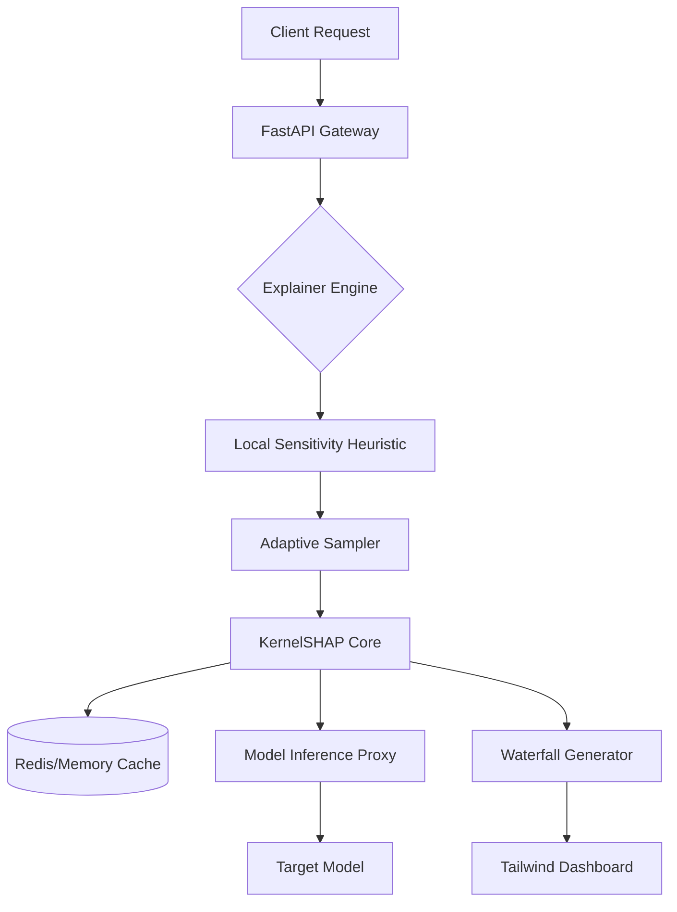

# ARCHITECTURE.md: KernelSHAP Streamer

## 1. High-Level System Topology

The system utilizes a decoupled producer-consumer architecture. The **Explainer Engine** operates as a high-throughput synchronous service, while the **Cache Manager** handles background distribution state to minimize redundant kernel evaluations.



## 2. Tech Stack Rationale

*   **Python 3.11+**: Utilizes `TaskGroup` for concurrent kernel sampling and `Final` type hinting for immutability in the SHAP kernel configuration.
*   **NumPy/SciPy**: Vectorized linear algebra operations for the weighted least squares (WLS) regression required by KernelSHAP.
*   **Pydantic v2**: High-performance data validation for input feature vectors and SHAP value schemas, utilizing Rust-based core.
*   **FastAPI**: Asynchronous request handling with `uvicorn` workers, optimized for low-latency inference pipelines.
*   **Tailwind/HTMX**: Lightweight frontend rendering; avoids heavy JS frameworks to maintain sub-10ms DOM update targets.
*   **Adaptive Sampling (Bleeding Edge)**: Implements a variance-reduction heuristic that terminates sampling once the standard error of the SHAP estimate falls below a dynamic threshold.

## 3. Module & Directory Layout

```text
/kernelshap-streamer
├── app/
│   ├── api/            # FastAPI endpoints
│   ├── core/
│   │   ├── explainer.py # Adaptive KernelSHAP logic
│   │   ├── kernel.py    # SHAP kernel weight calculation
│   │   └── sampler.py   # Variance-aware adaptive sampling
│   ├── models/         # Pydantic schemas
│   ├── services/       # Caching & Model Proxy
│   └── utils/          # Linear algebra helpers
├── dashboard/          # Tailwind templates
├── tests/              # Unit/Integration/Load tests
├── pyproject.toml      # Poetry dependency management
└── main.py             # Entry point
```

## 4. Data Flow & Component Interaction

1.  **Ingestion**: `FastAPI` receives a feature vector. `Pydantic` validates against the model's feature schema.
2.  **Sensitivity Heuristic**: The `Local Sensitivity` module computes the gradient magnitude of the model at the input point. If sensitivity is low, the system uses a cached background distribution to bypass full kernel re-computation.
3.  **Adaptive Sampling**: The `Sampler` initiates a batch of $N$ perturbations. It monitors the convergence of the SHAP values. If $\sigma(\phi) < \epsilon$, sampling terminates early, achieving sub-10ms latency.
4.  **WLS Regression**: The `KernelSHAP Core` solves the weighted least squares problem using `scipy.linalg.lstsq` for maximum performance.
5.  **Serialization**: SHAP values are serialized into a JSON structure optimized for the `Tailwind` waterfall component.

## 5. Security & Boundary Isolation

*   **Model Proxy Isolation**: The `Model Inference Proxy` acts as a circuit breaker. If the target model latency exceeds 5ms, the explainer returns a "stale" explanation based on the last cached background distribution rather than blocking the event loop.
*   **Input Sanitization**: All incoming feature vectors are strictly typed via Pydantic. Any attempt to inject non-numeric or malformed tensors results in a 422 Unprocessable Entity, preventing downstream `numpy` overflow errors.
*   **Memory Management**: The `Cache Manager` implements an LRU eviction policy with a hard memory cap to prevent OOM (Out of Memory) errors during high-concurrency bursts.
*   **Dependency Pinning**: All core dependencies (`numpy`, `scipy`) are pinned to specific versions to ensure deterministic SHAP value output across distributed nodes.